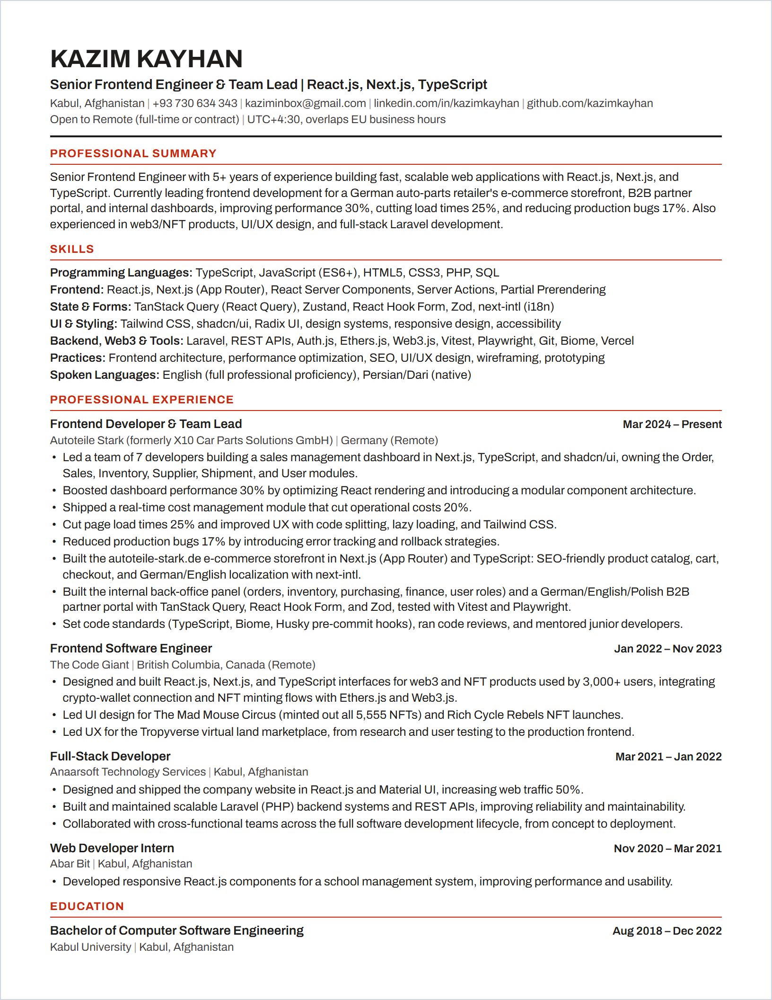

<!-- markdownlint-disable MD033 MD041 -- the résumé image is the page; HTML is needed for centering, sizing and the collapsible docs -->
<div align="center">

**[View online](https://kazimkayhan.github.io/resume/)** · **[Download PDF](public/Kazim-Kayhan-Resume.pdf)**

<a href="https://kazimkayhan.github.io/resume/"></a>

</div>

<details>
<summary><strong>How this résumé is built</strong></summary>

<br>

Single-page, ATS-friendly résumé built with [Astro](https://astro.build). All content lives in `src/data/resume.ts`; the web page, the PDF and the image above all render from it.

### Commands

```bash
pnpm install
pnpm exec playwright install chromium   # first time, and after upgrading Playwright
pnpm dev       # live preview at http://localhost:4321/resume/
pnpm pdf       # writes public/Kazim-Kayhan-Resume.pdf (US Letter) and .github/resume.png
```

`pnpm pdf` refuses to write anything if the résumé runs past one page or the Archivo font fails to load. The README image is the same layout captured at 2x, exactly 8.5 × 11 in.

### Publishing

1. Edit `src/data/resume.ts`, run `pnpm pdf`, and commit the change together with `public/Kazim-Kayhan-Resume.pdf` and `.github/resume.png`.
2. Push to `main`. `.github/workflows/deploy.yml` builds the site and deploys it to GitHub Pages, with the committed PDF behind the page's "Download PDF" button.

The PDF is generated locally rather than in CI so the published file is exactly the one you checked (Linux font rendering can shift line breaks). The workflow fails if `src/` or `scripts/` changed after the PDF or image was last committed, so stale output never goes live.

One-time setup: in the GitHub repo, Settings → Pages → Build and deployment → Source: **GitHub Actions**.

### ATS notes

- Real, selectable text (no outlined glyphs or images), single column, standard section headings (Professional Summary, Skills, Professional Experience, Education). Education stays last so its right-aligned date can't be grouped into another section by layout-based parsers.
- Job title, then company and location on their own line, then dates right-aligned; dates use `Mon YYYY – Mon YYYY`.
- Semantic HTML: `h1` name, `h2` sections, `h3` roles, lists for bullets. The PDF is tagged, so parsers get an explicit reading order.
- Ligatures are disabled so words like "profile" extract as plain letters.
- PDF Title, Author, Subject, Keywords and language are set from the page.

</details>
